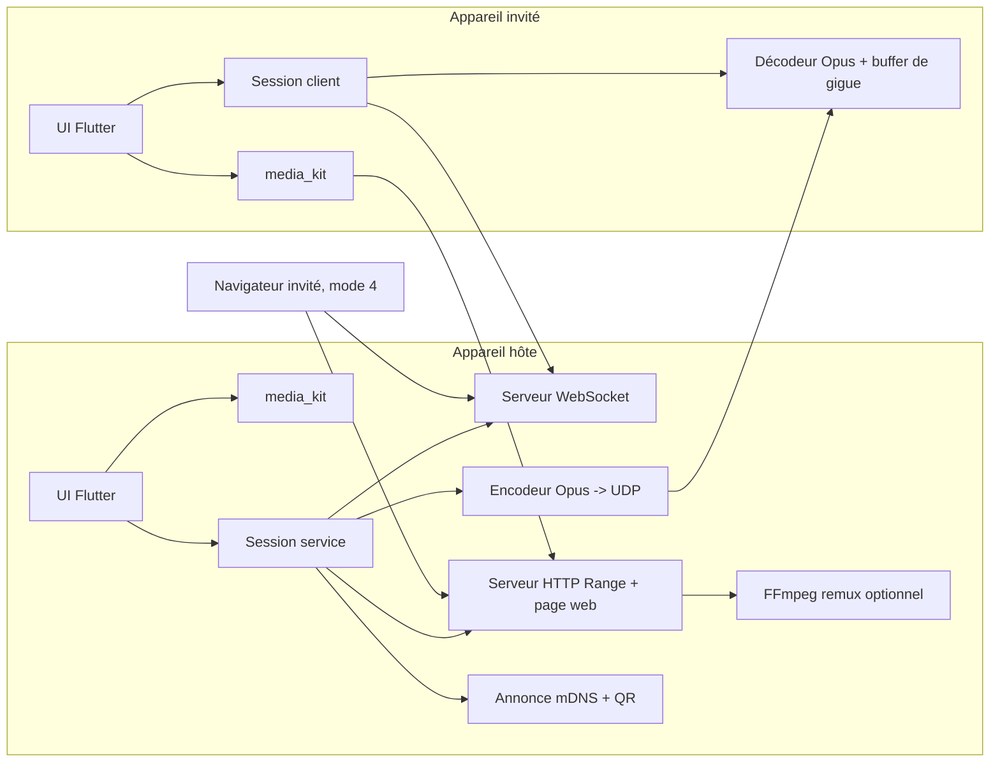

# App Synchro Film — Architecture

Application légère Android + Windows pour synchroniser la lecture d'un fichier multimédia local entre deux appareils, en Wi-Fi, **100 % hors-ligne** (partage de connexion ou réseau local sans Internet).

## 1. Choix techniques

| Domaine | Choix | Raison |
|---|---|---|
| Framework | **Flutter** (Android + Windows, une seule base de code) | Un seul code, bonnes perfs, écosystème mature |
| Lecteur | **media_kit** (libmpv) | Quasi tous formats (MKV, HEVC, AC3/DTS…), décodage matériel |
| Découverte | **mDNS** (`_synchrofilm._tcp`) + **QR code** (IP:port) en secours | Zéro saisie ; le QR couvre les hotspots qui filtrent le multicast |
| Contrôle / synchro | **WebSocket** + synchro d'horloge type **NTP** | Léger, bidirectionnel, compatible navigateur |
| Stream vidéo | **HTTP progressif** (requêtes Range) + **remux FFmpeg à la volée** vers MP4 si besoin | Aucun réencodage, coût CPU/batterie minimal |
| Stream audio seul | **Opus** sur **UDP** + compensation auto de la latence Bluetooth + curseur manuel | ~20 ms de latence codec, robuste, faible débit (~128 kb/s) |
| Politique de synchro | Hôte = horloge de référence, **les deux pilotent**, **correction douce** | Lecture fluide, écart cible < 50 ms |

## 2. Vue d'ensemble



## 3. Les 4 modes

### Mode 1 — Synchro double fichier
- Chaque appareil lit **son propre fichier** ; vérification d'identité du fichier (taille + hash partiel des premiers/derniers Mo) à la connexion.
- Seules les commandes et la position transitent par WebSocket.

### Mode 2 — Stream complet App ↔ App
- L'hôte expose `GET /media/{id}` avec support `Range` ; l'invité ouvre l'URL dans media_kit (aucun réencodage, tous formats).
- Synchro identique au mode 1.

### Mode 3 — Stream audio seul (écran partagé)
- L'hôte affiche la vidéo et joue (ou non) le son localement ; la piste audio décodée est réencodée en **Opus** (trames de 20 ms) et envoyée en **UDP**.
- L'invité : buffer de gigue adaptatif → décodage → sortie audio.
- **Compensation Bluetooth** : lecture de la latence de sortie rapportée par l'OS (Android `AudioTrack`/`AudioManager`, Windows WASAPI) + **curseur manuel** (−500 à +500 ms) ; la valeur est mémorisée par appareil de sortie.
- L'hôte peut aussi retarder sa propre vidéo si l'écouteur le plus lent dépasse un seuil.

### Mode 4 — Stream vers navigateur
- L'hôte sert une petite page web statique (HTML/JS, embarquée dans l'app) + `/media/{id}`.
- Si le conteneur n'est pas lisible (ex. MKV), **remux FFmpeg à la volée** en MP4 fragmenté, sans réencodage.
- La page se connecte au même WebSocket pour la synchro (`playbackRate` pour la correction douce).
- **Limite** : codecs non supportés par le navigateur (HEVC, AC3/DTS selon navigateur) → message clair à l'utilisateur ; pas de transcodage vidéo par défaut.

## 4. Protocole de synchro

Messages JSON sur WebSocket :

| Message | Contenu |
|---|---|
| `hello` | version, nom de l'appareil, mode, empreinte du fichier |
| `ping` / `pong` | t0, t1, t2 (estimation offset + RTT, type NTP, filtrage médian sur 8 échantillons) |
| `state` | `{playing, position, rate, at: hostClockMs}` — émis à chaque changement + toutes les 2 s |
| `cmd` | `play`, `pause`, `seek(pos)` — envoyé par **n'importe quel** pair, l'hôte arbitre et rediffuse un `state` |

**Correction douce** (côté invité) :
- écart < 40 ms : rien ;
- 40 ms – 1 s : vitesse ajustée de ±2 % jusqu'à résorption ;
- > 1 s : `seek` direct.

**Conflits** : l'hôte applique les commandes dans l'ordre de réception, horodatées par son horloge (la dernière gagne).

## 5. Connexion hors-ligne

1. L'hôte démarre une session → ouvre les serveurs (WS + HTTP + UDP sur ports fixes configurables) → s'annonce en mDNS → affiche un QR code `synchrofilm://IP:port?token=...`.
2. L'invité voit la session apparaître, ou scanne le QR (Android) / saisit l'adresse (Windows).
3. Un **token de session** court protège la connexion (réseau local, pas de chiffrement lourd pour économiser la batterie).
4. Mode 4 : le QR encode directement `http://IP:port/` pour ouverture dans le navigateur.

## 6. Économie de batterie
- Aucun transcodage vidéo ; remux uniquement si nécessaire.
- Décodage matériel activé par défaut dans media_kit.
- Serveurs démarrés uniquement pendant une session ; mDNS arrêté une fois l'invité connecté.
- Messages `state` espacés (2 s) hors changements ; ping d'horloge toutes les 10 s après convergence.
- Android : `WakeLock` partiel seulement pendant la lecture ; service au premier plan pour le mode hôte.

## 7. Structure de projet envisagée

```
lib/
  core/        # horloge, protocole, modèles
  net/         # mdns, websocket, http server, udp audio
  player/      # wrapper media_kit, correction douce
  modes/       # double_file, stream, audio_only, browser
  ui/
web_client/    # page HTML/JS servie en mode 4
native/        # FFmpeg remux, Opus, latence audio (plugins Android/Windows)
docs/
```

## 8. Limites connues
- Mode 4 limité aux codecs lisibles par le navigateur (H.264/AAC, VP9/Opus…).
- Pas de Wi-Fi Direct (non retenu).
- FFmpeg ajoute ~10–20 Mo à l'application.
- Latence Bluetooth annoncée parfois inexacte → d'où le réglage manuel.

## 9. Étapes suivantes
1. Squelette Flutter + media_kit (Android + Windows).
2. Protocole WS + synchro d'horloge + mode 1.
3. Serveur HTTP Range + mode 2.
4. Page web + remux FFmpeg + mode 4.
5. Pipeline Opus/UDP + compensation Bluetooth + mode 3.
